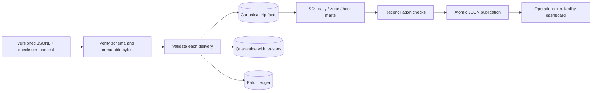

# Mobility Data Reliability

**A reproducible data engineering portfolio project: trustworthy daily trip metrics despite duplicate delivery, broken records and late corrections.**

**Status:** working local pipeline and computed dashboard data. **Data:** deterministic synthetic taxi-shaped records, not real NYC TLC trips. **Built with:** Python 3.9+, SQLite, SQL and GitHub Actions. No cloud account, paid service or third-party Python package is required.

## The business problem

An operations analyst needs daily trip volume, fare totals and pickup-zone demand. A naïve append-only load overcounts repeat deliveries, drops late trips from prior days, and silently changes totals when corrected fares arrive. The project makes those failure modes visible and recoverable.

**Decision:** can operations trust today's published snapshot, and which source issues need repair? The dashboard separates trip demand from ingestion quality; it does not pretend to optimize a real taxi fleet.

## Run it

From this repository directory:

```bash
python3 src/generate_demo.py
python3 src/pipeline.py
python3 -m unittest discover -s tests -v
```

Run the pipeline again: it verifies raw checksums, reports `skipped_unchanged` for all three batches, and produces the same dashboard values. To replay one immutable batch:

```bash
python3 src/pipeline.py --batch 02-late-arrivals.manifest.json
```

To rebuild from raw inputs without touching the existing warehouse:

```bash
python3 src/pipeline.py --db data/rebuilt.sqlite --output dashboard/rebuilt.json
```

The browser dashboard is delivered alongside this project in the portfolio. Its data lives in `dashboard/data.json`; [the schema is documented here](docs/dashboard-schema.md).

## What is implemented

- Immutable, versioned raw JSONL batches and SHA-256 manifests.
- Strict record contract with quarantined bad records and reason codes.
- SQLite transactions that commit facts, rejects and the batch ledger together.
- Idempotency by immutable `batch_id`; stable trip keys for duplicate suppression.
- Latest-version upserts; stale versions cannot reverse corrections.
- Same-version conflicting records quarantined rather than arbitrarily chosen.
- Event-date marts that include late arrivals and corrections on the original trip date.
- Row-accounting, uniqueness, validity and fare reconciliation checks before publication.
- Atomic dashboard file replacement; a failed publication preserves the last good file.
- Failure-injection tests for rollback, retries, corruption, ordering and publication.

## Reproduced results

The generated fixture contains three batches over **1–14 January 2026**:

| Measured result | Value |
| --- | ---: |
| Input deliveries | 7,679 |
| Canonical trips after deduplication | 7,200 |
| Duplicate deliveries suppressed | 297 |
| Invalid records quarantined | 80 |
| Applied trip corrections | 102 |
| Canonical fare total | $170,755.66 |
| Current trips arriving more than 24h after dropoff | 475 (6.60%) |
| Quarantine share of input rows | 1.04% |

These are measurements of the generated fixture, **not commercial impact or production scale**. Fare is positive fare only, not platform revenue, profit, tips or taxes. The 50-hour p95 arrival lag is synthetic event-time delay, not execution time.

## Architecture and evidence



Read [architecture and tradeoffs](docs/architecture.md), [data contract and metrics](docs/data-dictionary.md), [incident runbook](docs/runbook.md), and [case study](docs/case-study.md).

## Repository map

```text
src/generate_demo.py     Deterministic fixture, intentional faults and corrections
src/pipeline.py          Validation, transactions, upserts and atomic publication
src/fetch_tlc_zones.py   Optional official TLC lookup downloader only
sql/marts.sql           Canonical daily / zone / hourly / summary SQL views
tests/test_pipeline.py  Meaningful failure and correctness tests
docs/                   Architecture, metrics, runbook and measured case study
dashboard/data.json     Generated snapshot consumed by the dashboard
.github/workflows/      Automated verification configuration
```

## Public-data upgrade

The [official NYC TLC trip-record page](https://www.nyc.gov/site/tlc/about/tlc-trip-record-data.page) publishes monthly Parquet and zone reference data. This repository includes `python3 src/fetch_tlc_zones.py` to download and checksum the **real zone lookup only**. It is optional and requires network access. It is not part of the generated demo and has not been used to produce the displayed metrics. Synthetic zone codes are explicitly local; never join them directly to official TLC LocationIDs.

Before claiming an actual TLC pipeline, implement the Parquet adapter and a source-specific contract, then run it against an explicitly named month. TLC records lack this demo's application-supplied `trip_id`, `updated_at` and `received_at`; the adapter must define separate source-file/row lineage and ingestion timestamps rather than inventing real event versions. An identical row is not automatically a duplicate trip. The [architecture document](docs/architecture.md) scopes this work honestly.

## How to present it

**CV bullet after reproducing it yourself:** “Built a Python/SQL batch pipeline with immutable manifests, transactional upserts, quarantine and atomic dashboard publication; verified replay and failure recovery on 7,679 synthetic deliveries covering 7,200 canonical trips.”

**30-second interview explanation:** “I started from an analyst's trust problem: yesterday's totals changed after repeated and delayed deliveries. I made a canonical trip model and a batch audit ledger, then injected duplicates, invalid values, conflicts and crashes. The important evidence is that a failed batch commits nothing and replay does not inflate the metrics.”

**Technical discussion:** explain why batch idempotency differs from event deduplication, why source timestamps need a contract, why full local view recomputation is safe at this scale, and how partition repair would change at millions of rows.

**Claim boundary:** this demonstrates local engineering behavior, not hands-on deployed Airflow/S3/Spark experience. Cloud components in the design are a future implementation path. No live CI run is claimed until the workflow runs in GitHub.

## Interactive dashboard and portfolio

[Open the portfolio dashboard](https://beyza-data-portfolio.dewyisle36.chatgpt.site/#mobility-pipeline/dashboard) · [Project case study](https://beyza-data-portfolio.dewyisle36.chatgpt.site/#mobility-pipeline)

The hosted portfolio initially requires owner access. The self-contained local dashboard is available without hosting: open `dashboard/index.html`. After rerunning the data pipeline, run `python3 dashboard/refresh.py` to refresh its browser snapshot. All default dashboard figures are synthetic and generated by the pipeline.

AI assisted the initial code and documentation. Before using this project in applications, reproduce it, review its definitions and add an independently understood extension.
