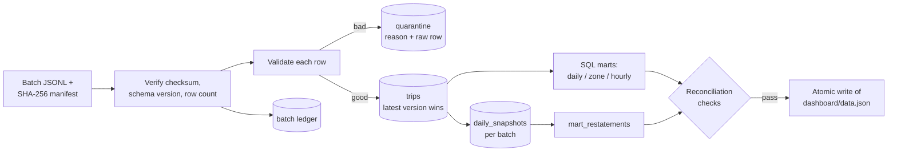

# Mobility Pipeline

An operations team looks at daily trip counts and fares every morning. The feed behind them resends records, delivers some trips days late, and corrects fares after the fact. A naive append-only load overcounts and quietly changes yesterday's numbers. This pipeline makes the daily figures something you can trust: every batch is verified, loaded in one transaction, deduplicated, and published only after reconciliation. It also records how much each day moved after it was first published.

**Stack:** Python (standard library), SQL (SQLite), GitHub Actions
**Data:** generated taxi-style trip records (seed 4026, 1–14 January 2026) with deliberate duplicates, bad rows, late arrivals and corrections. Not real NYC TLC data.
**Dashboard:** [project page](https://beyzamercanse.github.io/project1/work/mobility-pipeline.html) · or open `dashboard/index.html` locally

## Key numbers

| | |
|---:|---|
| 7,679 | rows delivered across 3 batches |
| 7,200 | canonical trips after deduplication |
| 297 | duplicate deliveries suppressed |
| 80 | invalid rows quarantined with a reason (1.04%) |
| 102 | fare corrections applied to the original trip date |
| 14 of 14 | days restated after first publication |
| +7.47% | largest change to a day's fare total after it was first published |
| $170,755.66 | final fare total (positive fares only, not revenue) |

## Architecture



Facts, quarantine rows, the batch ledger and the daily snapshot for a batch are written in **one transaction**. If anything fails partway, none of it is committed.

## How it works

**Immutable batches.** Each batch has a manifest with its SHA-256, row count and schema version. A batch ID that was already loaded is skipped; the same ID with different bytes is an error, not an overwrite.

**Row contract.** Rows with missing fields, non-canonical timestamps, impossible durations, unknown zones or out-of-range fares/distances go to `quarantine` with a reason code and the raw line. Valid rows in the same batch still load. One bad row shouldn't hold up the other 7,000.

**Versions.** Trips are keyed by `trip_id` and ordered by `updated_at`. A newer version replaces the old one; an older or identical one counts as a duplicate. Two rows with the *same* version but different contents are quarantined as `conflicting_version`, because there's no safe way to choose.

**Event-time marts.** Daily numbers are grouped by pickup date, not arrival date. A trip that arrives two days late lands on the day it happened.

**Publication.** Before writing the dashboard file, the pipeline checks unique trip keys, that every input row is accounted for (accepted + rejected + duplicate = raw), valid fares and distances, that the zone mart sums to the total, and that the latest snapshot matches the daily mart. The file is written to a temp path and swapped in with `os.replace`. A failed write leaves the previous file intact.

## Restatement audit

Event-time marts fix history, but that means a day you looked at yesterday can change today. I wanted that to be visible, not something people discover when two reports disagree.

After each batch commits, the pipeline stores a snapshot of every day's trips and fare (in integer cents) in `daily_snapshots`, inside the same transaction. `mart_restatements` then compares each day's first published value with its current one and counts how many later batches changed it.

| Batch | Trips added to already-published days | Fare change | Days changed |
|---|---:|---:|---:|
| 02-late-arrivals | +379 | +$9,205.00 | 14 |
| 03-corrections | 0 | +$255.00 | 14 |

Every day in the fixture was revised twice after it first appeared, gaining about 27 trips and between 4.8% and 7.5% of its fare total. In practice that means a day shouldn't be treated as final until the late batch has landed (the p95 arrival lag here is 50 hours). The audit gives the team a number to put on that, instead of a feeling that the numbers "sometimes move".

## Run it

```sh
python3 src/generate_demo.py              # write the three batches + manifests
python3 src/pipeline.py                   # load, check, publish
python3 -m unittest discover -s tests -v  # 18 tests
python3 src/pipeline.py                   # rerun: every batch skipped_unchanged, identical output
python3 dashboard/refresh.py              # update the offline dashboard's data.js
```

Replay one batch, or rebuild everything into a separate database without touching the current one:

```sh
python3 src/pipeline.py --batch 02-late-arrivals.manifest.json
python3 src/pipeline.py --db data/rebuilt.sqlite --output dashboard/rebuilt.json
```

## Tests worth reading

- a crash halfway through a batch commits nothing (no facts, no ledger row, no snapshot), and the retry succeeds
- a checksum mismatch or unsupported schema version commits nothing
- a stale version can't undo a correction
- loading the batches in reverse order produces the same final trips and fares
- a late arrival restates its original day; a correction changes fare but not trip count; a pure duplicate isn't a restatement
- a failed atomic replace keeps the previous dashboard file

## Repository layout

```text
src/generate_demo.py     deterministic batches with injected faults
src/pipeline.py          validation, transactional load, snapshots, publication
src/fetch_tlc_zones.py   optional: download the official TLC zone lookup
sql/marts.sql            daily, zone, hourly, summary and restatement views
tests/                   failure, replay and restatement tests
docs/                    architecture, data dictionary, runbook, case study
dashboard/               static dashboard built from data.json
```

More detail: [architecture](docs/architecture.md) · [data dictionary](docs/data-dictionary.md) · [runbook](docs/runbook.md) · [case study](docs/case-study.md)

## Moving to real TLC data

The official [TLC trip records](https://www.nyc.gov/site/tlc/about/tlc-trip-record-data.page) are monthly Parquet files without a `trip_id`, `updated_at` or `received_at`, so the versioning here doesn't carry over directly. The next step is a Parquet adapter with its own lineage (source file + row number), a source-specific contract, and a measured runtime for one full month. The demo zone codes are local and must not be joined to TLC LocationIDs.
