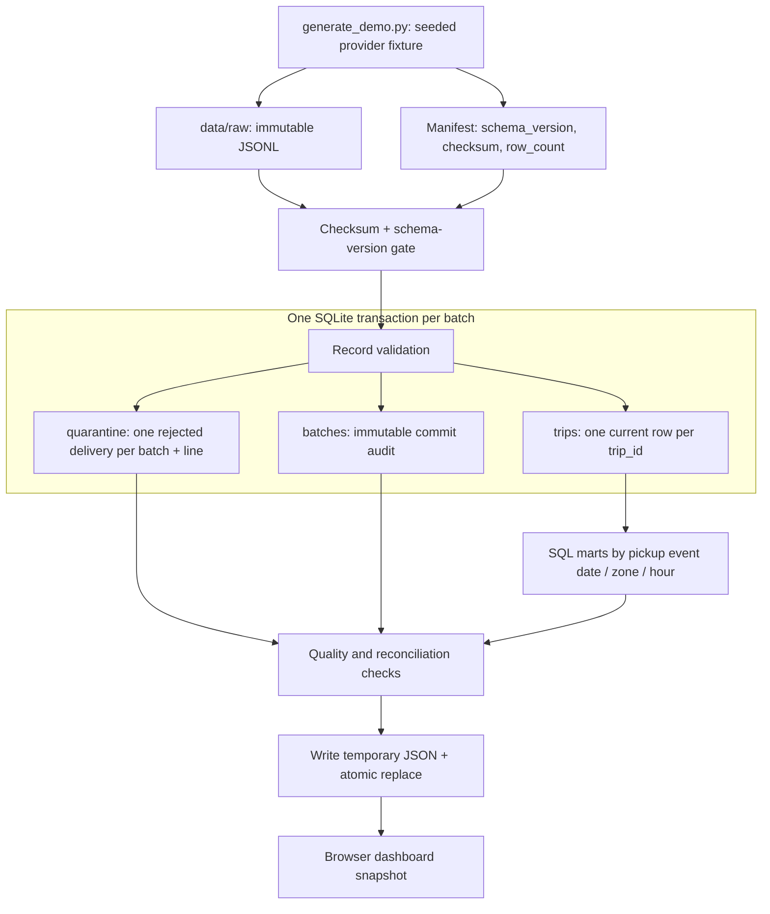
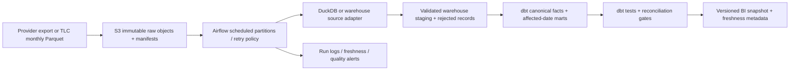

# Architecture and implementation design

## Users and acceptance criteria

The operations analyst needs trip count, positive fare totals, demand by local demo zone and time of day. The data engineer needs a visible audit trail and a deterministic recovery procedure.

Acceptance criteria:

1. Replaying any already committed unchanged batch produces no additional facts or ledger rows.
2. Every input row is accepted, quarantined, or classified as duplicate/stale; counts reconcile exactly.
3. A newer correction affects the original event date. An older version never reverses it.
4. A worker exception commits neither partial facts nor a completed batch entry.
5. A dashboard is replaced only after checks pass; filesystem failure preserves its previous bytes.
6. Source corruption fails before ingestion; it cannot be disguised as a valid replay.

## Implemented local architecture

| Layer | Grain / key | Implementation |
| --- | --- | --- |
| Raw | one delivery per JSONL line | versioned file + SHA-256 manifest |
| Batch audit | one committed batch | `batch_id` primary key; immutable checksum |
| Canonical fact | one current trip | `trip_id` primary key; compare `updated_at` |
| Quarantine | one invalid delivery | `(batch_id,row_number)` primary key |
| Daily mart | one pickup event date | view over current facts |
| Zone mart | one local pickup zone | view over current facts |
| Hour mart | one UTC pickup hour across the entire period | view over current facts |

The fixture's canonical timestamps are UTC. This is a test-source contract, not a claim that TLC source timestamps are UTC. For actual TLC data, source-local timestamp conventions and daylight-saving ambiguity must be addressed explicitly.

## Choices and tradeoffs

**SQLite and the standard library:** let anyone reproduce the failure behaviour without credentials or installation. SQLite is appropriate for the small single-writer demo, not a distributed warehouse benchmark.

**Latest-version canonical table:** the source promises stable trip IDs and monotonically increasing update times. Earlier versions remain available in raw files. Same-version records with conflicting fields are quarantined. Identical/stale versions are ignored; received time alone cannot revise a business fact.

**Immutable raw capture:** generator refuses changed bytes under the same filename; ingestion verifies every checksum, including a replay. This is application-enforced immutability, not storage-level object locking. Operators with write permissions can still change local files, which checksum verification detects unless all trust records are compromised.

**Late arrivals:** the pipeline uses event date, not ingestion date, for the analytical grain. Local marts are views over the entire canonical table, so corrections are reflected automatically. At warehouse scale, track affected event-date partitions and replace those partitions after validating the new version. Do not simply process `event_date >= yesterday`.

**Atomic commit and publication:** database mutation and the batch ledger share a transaction. The JSON snapshot is atomically replaced after validation. Database commit and file publication are not a distributed transaction: a failed publication can leave a newer database and an older dashboard. The next run verifies the batches and regenerates the snapshot. Tests cover this preservation behavior.

**Quarantine versus stop:** invalid individual records are isolated so valid data remains available. Unsupported batch schema, checksum mismatch and immutable-ID conflicts fail the whole batch. The current implementation does not automatically stop on a quarantine-rate threshold; the dashboard and runbook expose a proposed alert policy.

## Proposed cloud extension — not deployed

Start with bounded monthly batch processing. Streaming and Kafka are not justified by TLC's monthly publication cadence. Only introduce them for a different source with a real-time decision requirement.

Production implementation milestones:

1. Select one TLC year/month and retain its official data dictionary and downloaded-file checksum.
2. Implement a Parquet adapter with a separate schema version and explicit column mapping; preserve source filename and source row index.
3. Replace local demo IDs with official zones. Handle invalid/missing zones without mapping them to fake geography.
4. Use file hash + row position as source-record lineage. Do not invent reliable trip-level business keys from undocumented source columns. A hash of all attributes could collapse legitimate identical trips.
5. Make downloaded monthly files the backfill unit; preserve revisions under new immutable object versions.
6. Add orchestrator retries and bounded partition concurrency; test forced timeout, schema change and object replacement.
7. Measure row counts, query scan bytes, elapsed runtime and cost on the actual environment. Publish measurements and commands, never guessed percentages.
8. Wire cloud secrets through the platform's secret store and service accounts with minimum object/warehouse privileges.

## Service-level targets to implement

These are proposed targets, not observed production SLAs: publish within 30 minutes of a verified batch landing; page on checksum/schema failure; alert if reject rate exceeds 1% or grows 0.5 percentage points; explicitly show the latest source period. For monthly public sources, track expected release cadence separately from event age. A January historical sample is not a stale pipeline simply because today's date is November.
